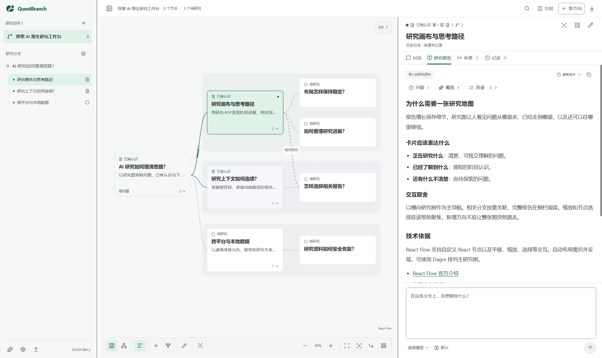

# QuestBranch

[简体中文](README.md) · English

**AI-Native Branching Research Workspace**

**See where each research branch stands. Continue from what you have learned.**

Start with a question and let your research grow into branches. A visual research map shows what each direction has uncovered and which questions remain. Select a node to continue researching with AI using the material already collected.

Each node represents a research topic and keeps its conversations, full reports, sources, and report history. Follow-up questions become child nodes that you can explore further.

This repository provides the standalone application's source code, releases, and user documentation. Public developer previews are available.

<picture>
  <source media="(prefers-color-scheme: dark)" srcset="docs/images/workspace-dark.png">
  
</picture>

## Choose your edition

| Edition                                                                                  | Models and tools                                   | Where to start                                                                                               |
| ---------------------------------------------------------------------------------------- | -------------------------------------------------- | ------------------------------------------------------------------------------------------------------------ |
| Standalone app (this repository)                                                         | Your model account, API, Ollama or ACP agent       | [Download](https://github.com/Ethan-decoy/QuestBranch/releases) · [Install](docs/desktop-installation.en.md) |
| [DSH integration](https://github.com/Ethan-decoy/QuestBranch-DSH/blob/main/README.en.md) | DeepSeek Harness models, tools and native sessions | Use the plugin's installation and compatibility instructions.                                                |

## Download and start

Published developer previews provide Windows x64 installer/ZIP, Apple Silicon and Intel macOS DMGs, and Linux x64 DEB/AppImage packages. Choose the actual release asset matching your OS and CPU, then verify SHA256SUMS.txt. Application packages do not require Node.js or pnpm.

See [installation and upgrades](docs/desktop-installation.en.md), the [Windows isolated trial](docs/windows-trial.en.md), and [FAQ](docs/faq.en.md). Windows is unsigned; Mac uses ad-hoc signing without Developer ID or notarization. Tested OS versions and limitations are recorded with each release.

1. Read the example or create your own research space and root question.
2. Connect a model or an agent. Tools and web search depend on the chosen connection; an account login alone does not enable them.
3. Discuss in a node. When directions are clear, ask AI to save a stage report and create those pending branches.
4. Select a direction to continue, compare specific report versions, then quit and reopen to resume.

The example stays available. Chat suggestions only fill editable drafts; child research does not run automatically. Follow the complete [first-research guide](docs/getting-started.en.md).

## Features

- Organize questions on a research canvas; expand or collapse branches, search, compare reports, and synthesize findings across directions.
- Continue conversations within a node. AI tools can save stage reports and agreed child branches while preserving original messages and report history.
- Connect supported accounts, API services, and Ollama through Pi AI, or use an agent's own tools and skills through ACP.
- Store research locally in SQLite, with workspace export and restore. The standalone desktop app supports choosing a research storage location and migrating data.
- Use a desktop-first workspace, with a local browser preview backed by the same research service.
- Simplified Chinese is the default interface language. Switch to English in **Settings → General** and save your local preference; research content stays in its original language.

## Run from source

Use Node.js **24 or later** and pnpm **11.1.3**. The package manager version is pinned.

```powershell
git clone https://github.com/Ethan-decoy/QuestBranch.git
cd QuestBranch
pnpm install --frozen-lockfile
pnpm dev:web
```

Open the [local browser preview](http://127.0.0.1:5173). For desktop development, use `pnpm dev`.

```powershell
pnpm check          # Formatting, localization, types, and behavioral tests
pnpm build          # Build Electron and the browser preview
pnpm preview        # Run the built browser preview
pnpm start          # Run the built Electron application
pnpm package:dir    # Build the current platform's app directory in release/
pnpm package:win    # Windows NSIS installer
pnpm package:mac    # DMG for the current Mac architecture
pnpm package:linux  # Linux DEB and AppImage
pnpm notices        # Generate notices for installed production dependencies
pnpm notices:check  # Check third-party notices against installed locked dependencies
```

Build packages on their target OS; use `--arm64` or `--x64` for Mac architectures. Packaging generates the platform's production-license inventory and explicitly avoids publication. Exit QB before replacing an application directory; the Windows entry is `release/win-unpacked/QuestBranch.exe`. See the [installation guide](docs/desktop-installation.en.md) and release assets for the verified OS/CPU scope.

## Connect models and save research

On first launch, open **Models & connections** to choose a model or agent. Direct model connections support accounts, APIs, and Ollama through the capability catalog provided by Pi AI. Agents connect through ACP using Codex or a custom backend. Account credentials are stored locally.

For an API service, select a provider and enter your key. Custom services also require a protocol and endpoint. Without a model connection, you can still create, organize, read, and export research. Reports in the starter workspace are labeled as project design material to introduce the workflow.

Press Enter to send and Shift+Enter for a new line by default. Change this in **Settings → Shortcuts**. The composer lets you select models and reasoning effort offered by the current connection. When asked to save a report or create agreed research directions, AI uses research tools to save them; child research does not start automatically.

The browser preview uses `.questbranch/` in the project directory by default. The Windows desktop app defaults to `%APPDATA%\questbranch\research`. See the [usage guide](docs/getting-started.en.md) for storage migration, export and restore, and environment configuration.

## Source layout

```text
src/research/  Research types, context, models, and retrieval adapters
src/desktop/   SQLite, research service, Electron main and preload
src/preview/   Local browser preview server
src/ui/        React canvas, reports, conversations, and settings
tests/         Behavioral tests
```

Report problems through [Issues](https://github.com/Ethan-decoy/QuestBranch/issues). See the [changelog (Simplified Chinese)](CHANGELOG.md) for version history. Remove keys and private research content before sharing feedback.

This project is licensed under [MIT](LICENSE). See [LICENSING.md](LICENSING.md) for the scope covering the fixed SessionWeave snapshot and historical versions, and [THIRD_PARTY_NOTICES.txt](THIRD_PARTY_NOTICES.txt) for third-party notices.
