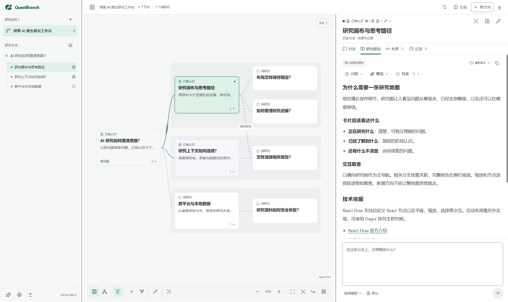

# QuestBranch 问之

简体中文 · [English](README.en.md)

**AI-Native Branching Research Workspace**

提出问题，让研究沿着分支逐渐深入。用可视化的研究图看清每个方向已经了解到什么、还有哪些问题，再选中一个节点让 AI 继续研究。

一个节点对应一项研究；节点保存对话、完整报告、来源与报告历史。后续问题成为可以继续深入的子节点。

本仓库提供独立应用的源码、版本和使用文档。当前提供公开开发者预发布。

<picture>
  <source media="(prefers-color-scheme: dark)" srcset="docs/images/workspace-dark.png">
  
</picture>

## 下载与试用

**0.3.0-dev.3 · Windows x64 预发布**

从 [Releases](https://github.com/Ethan-decoy/QuestBranch/releases) 获取完整 ZIP 与 `SHA256SUMS.txt`，核对后解压，双击顶层 `Start-QuestBranch.cmd`。无需安装 Node.js 或 pnpm；研究和配置保存在同级 `data/`。

安装、隔离试用和手动升级见 [Windows 试用指南](docs/windows-trial.md)，具体交付范围与已知限制见[发行说明](https://github.com/Ethan-decoy/QuestBranch/releases/tag/v0.3.0-dev.3)。当前未提供签名、自动更新或 macOS/Linux 成品。

## 功能

- 用研究画布组织问题，展开或收起分支，搜索、比较和综合不同方向的报告。
- 在节点中持续对话，让 AI 通过工具保存阶段报告与已确定的子分支；保留原始消息和报告历史。
- 通过 Pi AI 使用账号、API 服务与 Ollama，或通过 ACP 使用智能体自身的工具与技能。
- 用本地 SQLite 保存研究，支持研究空间导出与恢复；Windows 桌面可选择研究资料保存位置并迁移数据。
- 桌面优先，同时提供使用相同研究服务的本地浏览器预览。
- 默认简体中文，可在“设置 → 通用”切换 English 并保存本机偏好；研究内容保持原文。

## 从源码运行

需要 Node.js **24 或以上**及 pnpm **11.1.3**，包管理器版本已固定。

```powershell
git clone https://github.com/Ethan-decoy/QuestBranch.git
cd QuestBranch
pnpm install --frozen-lockfile
pnpm dev:web
```

打开 [本地浏览器预览](http://127.0.0.1:5173)。桌面开发使用 `pnpm dev`。

```powershell
pnpm check          # 格式、双语、类型与关键行为测试
pnpm build          # Electron 与浏览器构建
pnpm preview        # 启动构建后的浏览器预览
pnpm start          # 启动构建后的 Electron 应用
pnpm package:dir    # 构建并覆盖 release/ 中当前平台的应用目录
pnpm notices:check  # 核对本机锁定依赖与第三方声明
```

Windows 应用目录的固定入口为 `release/win-unpacked/QuestBranch.exe`。更新前先退出 QB，再次运行 `pnpm package:dir` 覆盖同一目录，本地构建不会发布版本。当前已验证 Windows 本地运行，macOS、Linux 的实际运行和安装包尚未验证；目前未提供签名安装包。

## 配置模型与保存研究

首次启动后，在“模型与连接”选择模型或智能体。直接模型可使用账号、API 或 Ollama，能力目录由 Pi AI 提供；智能体通过 ACP 连接 Codex 或自定义后端。账号凭据在本机保存。

使用 API 服务时选择提供商并配置密钥；自定义服务另外填写协议与地址。未配置模型时，可以正常创建、整理、阅读和导出研究。初始空间中的报告标有“项目设计资料”，用于介绍工作方式。

节点输入区默认 Enter 发送、Shift+Enter 换行，可在“设置 → 快捷键”修改；输入栏直接选择当前连接提供的模型与思考强度。要求保存报告或构建已确定方向时，AI 调用研究工具完成，不会自动开展子研究。

浏览器预览默认使用项目下的 `.questbranch/`；Windows 桌面默认使用 `%APPDATA%\questbranch\research`。迁移保存位置、导出恢复和环境配置见 [使用指南](docs/getting-started.md)。

## 源码结构

```text
src/research/  研究类型、上下文、模型与检索适配
src/desktop/   SQLite、研究服务、Electron main 与 preload
src/preview/   本地浏览器预览服务
src/ui/        React 画布、报告、对话与设置
tests/         关键行为测试
```

使用问题与缺陷请通过 [Issues](https://github.com/Ethan-decoy/QuestBranch/issues) 反馈。版本变化见 [CHANGELOG](CHANGELOG.md)。反馈时请移除密钥和私人研究内容。

本项目采用 [MIT](LICENSE)。固定 SessionWeave 快照及历史版本的许可范围见 [LICENSING.md](LICENSING.md)，第三方声明见 [THIRD_PARTY_NOTICES.txt](THIRD_PARTY_NOTICES.txt)。
